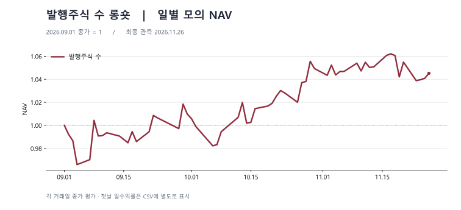

# 발행주식 수 롱숏 전략
한국 주식의 발행주식 수 변화로 종목을 순위화하고 롱·숏 포트폴리오를 구성한 QUANTIFI 5팀 연구다. 3개 하위계좌가 한 달 간격으로 진입해 각각 3개월을 보유한다.

## 일별 모의 NAV

[일별 수익률과 NAV 내려받기](보고서/일별_NAV.csv) · [전략보고서 PDF](보고서/QUANTIFI_발행주식수_전략보고서.pdf) · [제안서 원본 PDF](보고서/2026_가을학기_조현모_제안서.pdf)

2026년 9월 1일 **종가**가 1이다. CSV에는 기준일의 전일 대비 수익률도 담았다. 기준일 이후의 누적수익률은 표시 NAV에서 1을 빼면 된다.

세 하위계좌가 8월 말에 보유한 포지션과 각각의 다음 리밸런싱 날짜를 이어받아 종가로 평가한다. 일별 수익률에는 거래비용과 대차료를 반영한다. [11월 24일 기준 후속 운용보고서](보고서/QUANTIFI_발행주식수_OOS이후_일별추적.pdf)에서 카프로 가격손익 민감도와 월별 결과를 확인할 수 있다.

### 갱신 방법

이 프로젝트의 Windows 작업 스케줄러는 한국 시각 평일 20:40과 화~토 07:40에 공식 마감 시세를 확인한다. 등록된 사용자의 로그인과 인터넷 연결이 필요하다. 양 시장의 자료가 게시된 마지막 거래일까지 갱신하며, 다음 실행에서 누락 날짜를 따라잡는다. 진행 상태는 로컬 `비공개자료/일별_NAV_갱신.log`에 기록한다.

- 현재 원장으로 그래프를 다시 그릴 때는 `python daily_nav.py`를 실행한다. 지수 전략의 후속 종가 평가까지 갱신할 때는 아래 명령을 사용한다.
- 일별 시세 조회와 평가를 실행하려면 `python refresh_nav.py`, 결과를 GitHub에도 게시하려면 `python refresh_nav.py --publish`를 실행한다. KRX 유가증권·코스닥 일별매매정보 권한이 있는 키 파일의 위치를 `KRX_KEY_FILE` 환경변수로 설정한다.
- 발행주식 수 모델은 허가된 원본 노트북 입력 폴더를 `CSI_INPUT`, 복원한 추적입력 폴더를 `CSI_QUOTES`에 지정한다. 신규 종목매핑, 배당조정 시세 또는 기업행위를 검증하지 못하면 직전 검증 결과를 유지한다.

[이전 자료 목록](이전자료_목록.csv)에서 최초 이관 자료와 원본 해시를 확인할 수 있다.

## 연구 자료

| 연구 자료 | 확인할 내용 |
| --- | --- |
| [전략 노트북](CSI_strategy.ipynb) · [강건성 노트북](Robustness%20Test_last.ipynb) | 포트폴리오 구성과 검증 방법 |
| [발표 PDF](보고서/2026_가을학기_조현모_제안서.pdf) · [전략·운용보고서](보고서/) | IS 2012년 3월~2020년 12월, OOS 2021년 1월~2026년 8월 |
| [후속 일별 수익률 및 NAV](성과/추적_일별수익률_NAV.csv) | 2026년 9월 1일부터 이어지는 모의 운용 |

2026년 11월 24일 기준, 후속 추적은 OOS 종료 NAV 9.913986에서 10.308483으로 이어졌다(+3.98%). 카프로의 추적 기간 가격손익을 제외한 민감도는 −0.81%였다. 모형은 왕복 50bp와 연 3%의 대차료를 적용하며, 거래정지와 개별 종목의 대차 가능성이 실제 집행에 영향을 준다.

노트북을 처음부터 실행하려면 첫 데이터 로딩 셀의 상대경로에 사용 권한이 있는 수정주가, 거래대금, 시가총액 및 팩터 파일을 준비한다. 공개 파일에는 전략 코드와 계산 결과를 담았다.
